 

  

---

## 👋 Olá! Sou João Pedro

Sou estudante de Análise e Desenvolvimento de Sistemas na Universidade Estadual do Maranhão e estou construindo minha trajetória profissional na área de desenvolvimento de software.

Tenho me dedicado ao ecossistema Java, desenvolvendo projetos e aplicando conhecimentos em Programação Orientada a Objetos, Spring Boot, APIs REST, Spring Data JPA e bancos de dados relacionais.

Minha evolução acontece por meio da prática, da resolução de problemas e do aprofundamento contínuo dos conceitos de desenvolvimento.

Atualmente, também estudo testes automatizados com JUnit e segurança de aplicações com Spring Security e JWT.

Estou em busca de uma oportunidade de estágio em Back-End Java, na qual possa demonstrar minha dedicação, colocar meus conhecimentos em prática e continuar evoluindo como desenvolvedor.

---

## 📈 Histórico de Contribuições

## 🌐 Onde me encontrar

  
  
  
  

## 🛠️ Tech Stack

### Back-End

  

### Bancos de dados

  

### Testes

  

### Ferramentas e ambiente de desenvolvimento

  
  
  
  

<!---## 🚀 Projetos em destaque

### 🏛️ Procon MVP — Sistema de Gerenciamento de Cidadãos e Agendamentos

API REST desenvolvida com Java e Spring Boot para o gerenciamento de cidadãos e agendamentos de atendimento, com persistência de dados em PostgreSQL.

**Tecnologias:** Java, Spring Boot, Spring Data JPA e PostgreSQL.

**Funcionalidades e implementação:**
- Operações CRUD para gerenciamento de cidadãos.
- Cadastro e gerenciamento de agendamentos.
- Mapeamento de entidades e relacionamentos com JPA.
- Persistência e consulta de dados com Spring Data JPA.
- Endpoints REST com métodos HTTP e códigos de status apropriados.
- Validação de dados de entrada, incluindo validação de CPF (em andamento).

🔗 **Repositório:** [Procon MVP](https://github.com/Jpedro-Dev-tech)--->

<!---### 🏋️ Sistema de Gestão de Academia

Projeto de sistema web voltado ao gerenciamento de treinos, avaliações antropométricas e acompanhamento de alunos, desenvolvido no contexto do meu projeto acadêmico.

**Tecnologias:** Java, Spring Boot, Gradle e PostgreSQL.

**Objetivo do projeto:**
- Organizar informações relacionadas aos treinos e exercícios.
- Apoiar o registro e o acompanhamento de avaliações antropométricas.
- Desenvolver funcionalidades de gerenciamento por meio de uma API Back-End.

🔗 **Repositório:** [Sistema de Gestão de Academia](https://github.com/Jpedro-Dev-tech/Sistema-Gerenciamento-Academia)
--->
---

## 📚 Atualmente estudando
- Java e POO
- Desenvolvimento de APIs REST com Spring Boot.
- Spring Security e autenticação com JWT.
- Persistência de dados com JPA e Hibernate.
- Testes automatizados com JUnit.
- Arquitetura de software e boas práticas de desenvolvimento.
- Bancos de dados relacionais e SQL.

---

## 📊 GitHub Stats

  
 <!--- 
 --->

  

---